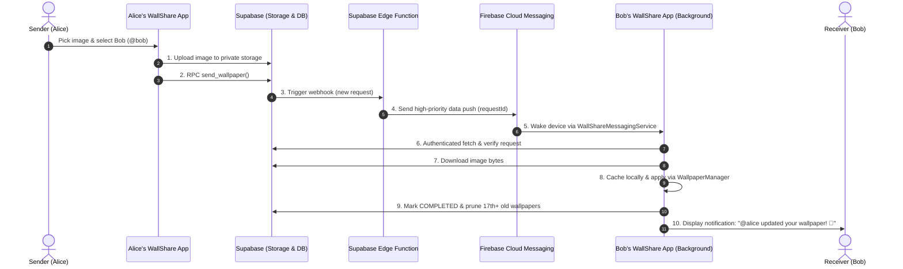

# 🎨 WallShare

WallShare is a modern, social Android application that lets friends securely share and apply wallpapers to each other's devices silently in the background. Built with Jetpack Compose, Supabase, Firebase Cloud Messaging, and WorkManager.

---

## ✨ Features

### 🔐 Authentication & Identity
* **Google Sign-In:** One-tap sign-in using Android's modern Credential Manager API.
* **Email & Password:** Traditional sign-up and sign-in option.
* **Unique Handles:** Claim a unique username (e.g. `@username`) with case-insensitive search and conflict resolution.
* **Seamless Session Management:** Persistent sessions with auto-refresh and one-tap sign-out.

### 👥 Social & Friends System
* **Live Search:** Instant username lookup with debounce.
* **Friend Requests:** Send, accept, reject, or cancel pending requests.
* **Mutual Request Auto-Accept:** Server-side atomic resolution if two users request each other simultaneously.
* **Friend Management:** View your friends list and unfriend at any time.

### 🚀 Wallpaper Dispatch Engine
* **Visual Picker:** Full-bleed image preview with high-resolution scaling.
* **Multi-Recipient Dispatch:** Send to a single friend, select multiple friends, or hit **Select All** with one tap.
* **Target Screen Selection:** Choose whether the wallpaper updates the **Home Screen**, **Lock Screen**, or **Both**.

### ⚡ Bulletproof Background Updates
* **Dual-Engine Delivery:**
  1. **Instant Push (FCM):** High-priority FCM data messages wake the device and trigger an expedited WorkManager job (`WallpaperWorker`).
  2. **Periodic Reconciler (`WallpaperPollWorker`):** Periodic WorkManager job (every 15 minutes) ensures wallpapers are never missed even if the device was offline or in deep doze.
* **Reboot Resilience:** `BootReceiver` restarts periodic polling automatically after system reboot.
* **OEM WakeLock Protection:** Acquires a partial wake lock during bitmap application to prevent vendor battery managers from killing the process before the OS writes the wallpaper to disk.
* **Smart Notifications:** Displays friendly user-facing notifications showing who updated your wallpaper (`@friend updated your home screen! ✨`).

### 🖼️ Wallpaper History & Gallery Downloads
* **History Feed:** Browse your last **16 received wallpapers** in a dedicated History tab.
* **Download to Gallery:** Save any received wallpaper directly to your device's photo gallery (`Pictures/WallShare`) via Android's `MediaStore` API.
* **Re-Apply Wallpapers:** Re-apply any wallpaper from your history back to your Home or Lock screen.
* **Full-Screen Viewer:** Tap any wallpaper for a full-resolution modal preview.

### 🛡️ Storage Safety & Auto-Pruning
* **Strict Supabase Bound:** To prevent storage overflow on Supabase's free tier, the app maintains at most 16 wallpapers per user. Any older wallpaper (17th+) is automatically deleted from both **Supabase Storage** and the database.
* **Zero Redundant Downloads:** Downloaded wallpapers are cached in app-internal storage for instant offline viewing in the History tab.

### ⚙️ User Preferences & Controls
* **Selective Auto-Apply:** Toggle automatic updates independently for Home Screen and Lock Screen.
* **Paused Mode:** If auto-apply is turned off for a screen, wallpapers still arrive safely in your History feed without disturbing your current wallpaper.
* **Battery Optimization Helper:** Quick shortcut to exempt WallShare from vendor battery restrictions.

---

## 🏗️ Architecture & Flow



---

## 🛠️ Tech Stack

| Layer | Technology |
| :--- | :--- |
| **Language** | Kotlin 2.0 (Kotlin Serialization, Coroutines, Flow) |
| **UI Framework** | Jetpack Compose + Material 3 (Rich Cyberpunk Dark Theme) |
| **Architecture** | MVVM + Repository Pattern + Clean Dependency Injection (`AppContainer`) |
| **Backend & Database** | [Supabase](https://supabase.com/) (PostgreSQL with RLS, Auth, Private Storage, Edge Functions) |
| **Push Notifications** | Firebase Cloud Messaging (FCM HTTP v1 API) |
| **Background Processing** | Android WorkManager (Expedited CoroutineWorkers + Periodic Sync) |
| **Image Loading** | Coil (Compose Image Loader) |
| **Authentication** | Android Credential Manager (Google ID Token) + Supabase Auth |
| **Local Storage** | Android `MediaStore` (Gallery export) + App-internal cache |

---

## 📁 Project Structure

```text
WallShare/
├── app/src/main/
│   ├── AndroidManifest.xml
│   ├── java/com/wallshare/app/
│   │   ├── MainActivity.kt                  # Root host, bottom navigation, auth state listener
│   │   ├── AppContainer.kt                  # Dependency injection container
│   │   ├── WallShareApplication.kt          # App startup & background worker initialization
│   │   ├── auth/                            # Authentication repository and ViewModel
│   │   ├── data/                            # Supabase client provider and shared models
│   │   ├── friends/                         # Friends repository, ViewModel, and data classes
│   │   ├── notifications/                   # FCM messaging service, DeviceRepository, BootReceiver
│   │   ├── wallpaper/
│   │   │   ├── WallpaperModels.kt           # WallpaperRequestRow, WallpaperHistoryItem, targets
│   │   │   ├── WallpaperRepository.kt       # Supabase RPCs, history queries, and auto-pruning
│   │   │   ├── WallpaperViewModel.kt        # Multi-friend send logic and UI state
│   │   │   ├── WallpaperWorker.kt           # Expedited background worker for applying wallpapers
│   │   │   ├── WallpaperPollWorker.kt       # 15-minute periodic poll reconciler
│   │   │   ├── WallpaperHistoryViewModel.kt # History feed, gallery downloads, and re-applying
│   │   │   ├── WallpaperStorageHelper.kt    # MediaStore gallery export and internal disk cache
│   │   │   └── WallpaperPreferences.kt      # Encrypted user preferences for auto-apply
│   │   └── ui/
│   │       ├── components/                  # WallpaperSettingsSheet, FriendListItem, RequestItems
│   │       ├── screens/                     # LoginScreen, UsernameScreen, FriendsScreen, SendWallpaperScreen, WallpaperHistoryScreen
│   │       └── theme/                       # Colors, typography, shapes, and Cyberpunk dark theme
│   └── res/                                 # Drawables, mipmaps, and XML configurations
├── supabase/
│   └── functions/
│       └── send-wallpaper-push/             # Deno Edge Function dispatching FCM pushes
└── README.md
```

---

## 🚀 Getting Started

### 1. Prerequisites
* **Android Studio:** Ladybug (2024.2.1) or newer.
* **JDK:** Version 17+.
* **Supabase Account:** Free project with Auth, Storage, and Database enabled.
* **Firebase Account:** Project with Firebase Cloud Messaging (FCM) enabled.

### 2. Configuration (`local.properties`)
Create or edit `local.properties` in the project root (never commit this file to version control):

```properties
sdk.dir=C\:\\AndroidSDK # (or your OS SDK path)
SUPABASE_URL=https://your-project.supabase.co
SUPABASE_ANON_KEY=your_supabase_anon_key
GOOGLE_WEB_CLIENT_ID=your_google_web_client_id.apps.googleusercontent.com
```

### 3. Add Firebase Configuration
Download `google-services.json` from your Firebase Console and place it in the `app/` directory:
```text
WallShare/app/google-services.json
```

### 4. Supabase Setup
1. **Database Tables:**
   - `profiles` (`id`, `username`, `display_name`, `created_at`)
   - `devices` (`id`, `user_id`, `push_token`, `platform`, `updated_at`)
   - `friend_requests` (`id`, `sender_id`, `receiver_id`, `status`, `created_at`)
   - `friendships` (`id`, `user_id_1`, `user_id_2`, `created_at`)
   - `wallpaper_requests` (`id`, `sender_id`, `receiver_id`, `image_path`, `target`, `status`, `created_at`)
2. **Storage:**
   - Create a private bucket named **`wallpapers`**.
3. **Edge Function:**
   - Deploy `send-wallpaper-push` located under `supabase/functions/send-wallpaper-push/`.
   - Set environment secrets in Supabase:
     ```bash
     supabase secrets set FIREBASE_SERVICE_ACCOUNT_JSON='{"type":"service_account",...}'
     ```

### 5. Build and Run
Open the repository in Android Studio, let Gradle sync, and run on a physical device or emulator running API 26+ (API 34/35 recommended).

```bash
# To compile and verify without IDE:
./gradlew compileDebugKotlin

# To package an installable debug APK:
./gradlew assembleDebug
```

---

## 📄 License
This project is licensed under the MIT License — see the [LICENSE](LICENSE) file for details.
